# 04 Data and ledger flow

Where each kind of data is stored, what crosses the tenant boundary (`org_id`), and what leaves for third parties. First drawn at `e5c23fd`, re-checked against main at `245985d` on 21 Nov 2026.

```mermaid
flowchart TB
  subgraph Req["One request, tenant bound by the auth dependency"]
    U["Caller JWT or API key"] --> Dep["org_id taken from the DB user row"]
  end

  subgraph PGgrp["PostgreSQL, rows carry org_id"]
    T1["Identity: organisations, users,<br/>api_keys, org_api_keys, saml_configs,<br/>scim_groups, portal_tokens"]
    T2["Runs: runs with checkpoint JSON,<br/>run_specs, decisions, phase_completions,<br/>pipeline_events, snapshots"]
    T3["Artifact index: artifact_embeddings<br/>text plus vector, pgvector if present"]
    T4["Learning: golden_builds, global_patterns,<br/>build_feedback, user_learning_patterns"]
    T5["Billing and spend: billing_payments,<br/>token_budget_records, llm_call_records,<br/>llm_traces, llm_cache_entries"]
    T6["Prime: prime_requests, prime_delegations,<br/>prime_org_limits, prime_corrections"]
    T7["Audit: audit_log rows plus audit_chain<br/>one hash chain per org, audit_checkpoints"]
  end

  subgraph Redisgrp["Redis, keys are mostly run or user scoped"]
    R1["api_rate:org and api_rate:user, rl:key"]
    R2["jwt:blacklist, jwt:family_revoked,<br/>jwt:refresh_cutoff, sse, oauthstate"]
    R3["pipeline:events channel, pipeline:history list 24 h,<br/>pipeline:control cancel and pause flag 1 h"]
    R4["startlock:org, app:state, app:current_run"]
  end

  subgraph Diskgrp["Gateway host disk, ~/.aether_os"]
    D1["projects/run_id: generated workspace"]
    D2["chroma_memory: ChromaDB vector memory"]
    D3["ledger_anchors.jsonl and ledger_signing_key.pem"]
  end

  subgraph Velgrp["Velaris deployment, one org"]
    V1["VELARIS_DATA: sealed sqlite stores,<br/>files, trace.jsonl hash chain"]
    V2["Vault master key file<br/>outside VELARIS_DATA, mode 0600"]
  end

  subgraph Third["Leaves the platform"]
    X1["Model providers: prompt and system text"]
    X2["S3 bucket: runs/run_id/files"]
    X3["LangSmith: traces if opted in"]
    X4["Stripe and Razorpay: billing data"]
  end

  Dep --> T1
  Dep --> T2
  Dep -->|"run files"| D1
  T2 -->|"after run"| T3
  D1 -->|"embed"| T3
  D1 -->|"upload if S3_BUCKET"| X2
  T2 --> T4
  Dep --> R1
  Dep --> R2
  T2 --> R3
  Dep -->|"every mutating call"| T7
  T7 -->|"periodic signed checkpoint"| D3
  Dep -->|"LLM call"| T5
  T5 -->|"admit then record"| X1
  Dep -->|"signed identity, org claim"| V1
  V2 -.->|"unlocks"| V1
  Dep --> T6
  T6 -->|"ledger"| T7
  Dep --> X4
  Dep --> X3
```

Derived from:

- Tables by group: `core/models.py` (`organisations :16`, `users :53`, `runs :87`, `decisions :173`, `audit_log :234`, `artifact_embeddings :266`, `token_budget_records :326`, `llm_call_records :345`, `golden_builds :504`, `pipeline_events :525`, `llm_traces :536`, `run_specs :434`), `core/audit/chain.py:77-95` (`audit_chain`), `core/audit/checkpoints.py` (`audit_checkpoints`), `core/audit/subjects.py` (erasure tables), `prime/models.py` (four Prime tables), `core/billing/payments.py` (`billing_payments`), `core/identity/portal_access.py` (portal tokens), `core/scim_models.py`.
- Tenant boundary: org id comes from the user row, not the token (`gateway/dependencies.py`); run scoped routes check run ownership first, 404 not 403 (`gateway/dependencies.py`); run rows and golden builds carry `org_id` (`core/models.py`, ). Ledger chain per org: `core/audit/chain.py:1-12,132-139`; platform events and legacy rows have their own chains (`:46-52`).
- Ledger write path: every mutating authenticated request is logged after the response (`gateway/api.py`); policy denials (`core/policy/enforce.py:53-60`); Velaris calls are ledgered before the call (`gateway/velaris_proxy.py`); Prime (`prime/approvals.py`). One call writes an `audit_log` row and an `audit_chain` entry, and marks the row `chain_linked=False` if the chain write failed (`core/audit/ledger.py:141-190`). Emails and IPs are hashed before they reach the chain (`ledger.py:149`).
- Anchors: `core/audit/anchor.py:1-30` (verify the chain, sign the head, append to a local file and to `audit_checkpoints`); file and key paths `core/audit/checkpoints.py:37,63-67`; periodic job `AETHER_LEDGER_ANCHOR_INTERVAL` (`anchor.py:180,196`); routes `gateway/routers/ledger_anchor_router.py:62-106`. The customer keeps exported checkpoints to detect rewriting (`anchor.py:14-21`).
- Artifacts: files on disk under `~/.aether_os/projects/<run_id>` (`core/projects.py:16`); embedded into `artifact_embeddings` (`core/artifact_store.py`); read order DB, disk, then S3 (); S3 key `runs/<run_id>/<path>` (); upload scheduled at run end (`orchestrator/artifact_collector.py:93-109`).
- Vector: pgvector only if package, PostgreSQL, extension and column all exist, otherwise a JSON scan (`core/vector_store.py:1-10`); ChromaDB at `~/.aether_os/chroma_memory` (`core/memory/vector_store.py:14,43-50`).
- Golden examples: table `golden_builds`; seeded from JSON files when empty at startup (`gateway/lifespan.py`).
- Redis keys: `core/api_rate_limit.py:59-61`; `gateway/auth_refresh.py`; `core/pipeline_state.py`; `core/start_lock.py:33`; `core/app_state.py:31-32`; `core/rate_limiter.py` (`rl:`). Cancel flag `pipeline:control:{run_id}` expires after 3600 s (`pipeline_state.py:152`); history list 86400 s (`:116`).
- Spend: check before every LLM call (`core/llm/guard.py`), record after (`core/model_router.py`); cache hit records zero cost ().
- What goes to model providers: the prompt and system text of each call. Sensitive prompts (keys, card numbers, ids, bulk emails: `core/llm/sensitivity.py:1-25`) are barred from OpenRouter (`core/model_router.py`); free OpenRouter models are barred unless `ALLOW_COMMUNITY_LLM` is set (). Event payloads are redacted before publishing (`core/pipeline_state.py`).
- Velaris: data dir and trace chain `velaris/intel/trace.py:36-41` (Velaris repo); vault key must not be inside `VELARIS_DATA` and must be mode 0600 `velaris/core/vault.py:8-10,49-52`; one organisation per deployment `velaris/core/access.py:131-143`; shared `velaris_data` volume for API and public app `docker-compose.yml`.
- LangSmith opt in: `core/telemetry/langsmith_tracer.py:31-43`.

Changes since the first drawing: PostgreSQL access goes through a circuit breaker (503 while the database is down, `core/db.py`); the compose database image is `pgvector/pgvector:pg15` because the schema has a vector column; the empty database bootstrap creates the ledger triggers, indexes and pgvector (`322cf4f`); Velaris keeps its vault key in a file mounted outside the data volume (`VELARIS_VAULT_KEY_FILE`, `docker-compose.yml`).

Not shown / not verified:

- Nothing was run; no database was inspected. Table lists come from model classes, which may differ from the live schema (Alembic owns it: `docker-compose.yml`).
- Not every table is listed (guardian, notifications, webhooks, marketplace, onboarding and others exist).
- The exact content of an LLM prompt per stage was not read. Whether source code of the generated app or customer text in `raw_input` is redacted before it is sent was not verified; only the sensitivity screen and provider restriction were read.
- Embedding calls (`core/llm/client.py:403-444`) go to Ollama or Bedrock; which one runs depends on configuration and was not traced.
- The anchor file and its signing key sit in the same directory as the project files on the same host or volume (`checkpoints.py:37,63-67`). Whether they are copied off the host automatically was not checked (the customer export route exists).
- Velaris store formats beyond the files named were not read; Velaris sealed sqlite and field sealing are in `velaris/core/sealed_sqlite.py` and `fieldseal.py` (not read).
- Where Velaris proxy data is stored on the AetherOS side: only ids and field names go to the ledger (`velaris_proxy.py:12-15`); message bodies are not stored by the proxy. Not tested.
