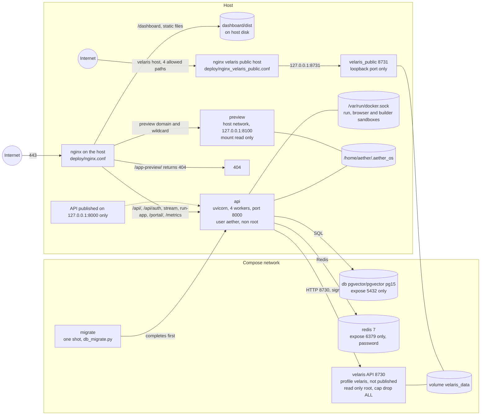
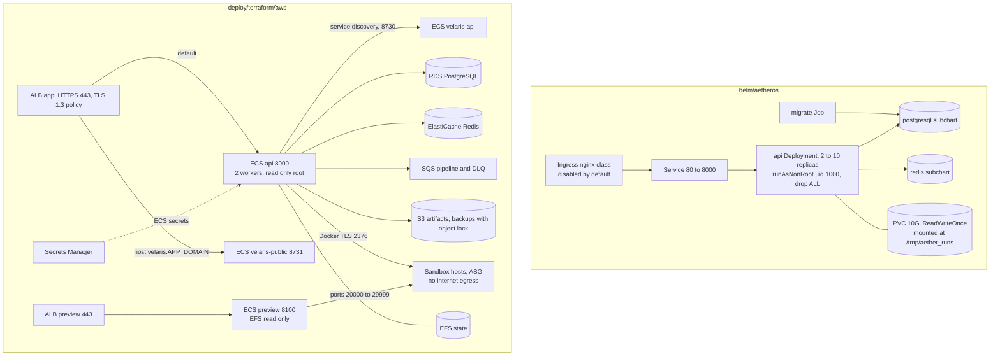

# 05 Deployment view

Status: NOT VERIFIED BY A REAL RUN. No Docker, nginx, Helm or Terraform command was run. Everything below is read from the files (first at `e5c23fd`, re-checked against main at `245985d` on 21 Nov 2026).

Four deployment descriptions exist and they are not the same system: single host with compose and host nginx, staging compose, Helm, and AWS Terraform. Differences are listed after the diagrams.

## 5a. Single host: docker-compose.yml with host nginx

## 5b. Helm chart and AWS Terraform

Nginx routing summary (compose and host nginx only):

| Public path or host | Goes to | Where |
| --- | --- | --- |
| `/dashboard/` | static files from `/home/aether_os/dashboard/dist` | `deploy/nginx.conf:97-102` |
| `/api/auth/` | gateway 8000, zone `auth` 30 per min | `:140-145` |
| `/api/factory/runs/{id}/stream` | gateway, zone `sse`, buffering rules for SSE | `:117-122` |
| `/api/` | gateway, zone `api` 600 per min, burst 100, 10 MB body | `:171-187` |
| `/portal/`, `/metrics` | gateway | `:196-211` |
| `/app-preview/` | 404 (previews use the preview domain) | `:191-192` |
| preview domain and `*.` subdomains | `127.0.0.1:8100` preview server | `:229-263` |
| Velaris public host: `/careers/ /schedule/ /interview/ /sign/` | `velaris_public_backend` (8731), all else 404 | `deploy/nginx_velaris_public.conf:67-73` |
| Velaris API | no nginx route; only the gateway reaches port 8730 | `docker-compose.yml:174,191-192` |

Derived from:

- Compose services, ports, volumes, health checks: `docker-compose.yml` (db, `expose` only, `pg_isready`),  (redis, password, `noeviction`),  (migrate),  (api: `ports "8000:8000"` at , `REQUIRE_REDIS` , health `/healthz` , `group_add DOCKER_GID` , socket and home mounts ),  (preview: host network, bind 127.0.0.1:8100, read only mount, no database or Docker socket),  (velaris: `read_only`, `cap_drop ALL`, `no-new-privileges`, port 8730 `expose` only, public key mounted read only),  (velaris_public, `127.0.0.1:8731`).
- Secrets source in compose: environment variables interpolated from the host `.env` (`${VAR:?...}` throughout `docker-compose.yml`); the Velaris private key goes in as PEM text ; the Velaris public key is a file . Secrets Manager in Terraform: `deploy/terraform/aws/modules/data/main.tf` (`aws_secretsmanager_secret`), injected as ECS `secrets` `modules/compute/services.tf:4,35,57,78,100`. Helm: `helm/aetheros/templates/secret.yaml:31,72-74`. Plain Kubernetes manifests: `deploy/kubernetes/api.yaml:56-122` (`secretKeyRef`).
- Non root: `Dockerfile` (`USER aether`; preview uses the same image). Helm `values.yaml` `securityContext` (`runAsNonRoot`, `runAsUser 1000`, `allowPrivilegeEscalation false`, `drop ALL`, `readOnlyRootFilesystem false`). Terraform `modules/compute/services.tf:136` (`readonlyRootFilesystem true`); the task definition sets no user, so the image user applies. Velaris compose services set no `user:`; the image was not inspected.
- Health: compose `/healthz` (`docker-compose.yml`); `Dockerfile`; Helm probes `/api/health` (`values.yaml`); `deploy/kubernetes/api.yaml:135,143` use `/health`; Terraform `/healthz` (`services.tf:37`), preview `/__preview/health` (`:59`), Velaris `/health` on 8730 (`:80`). Routes exist at `gateway/routers/health_router.py`.
- Staging: `docker-compose.staging.yml`: db, redis, migrate, api only; api published at `127.0.0.1:8001:8000` (); no preview, no Velaris, no Docker socket, no `AETHER_SANDBOX` or preview variables; data in a named volume ().
- Helm: `helm/aetheros/Chart.yaml` (postgresql and redis Bitnami subcharts), `values.yaml` (replicas 2, HPA 2 to 10, PVC RWO 10Gi at `/tmp/aether_runs`, ingress disabled by default), `templates/configmap.yaml:63-66` (sandbox, preview origin required, Velaris URL). `templates/migrate-job.yaml` runs migration.
- Terraform: `modules/compute/services.tf:8-17,41-50,63-66,84-87` (four services and ports; api 2 workers), `modules/compute/main.tf:353-374` (ALB default to api, host rule to velaris-public), `:86-176` (security groups: 8000 from the ALB, 8730 only from AetherOS tasks, 2376 and 20000 to 29999 for sandboxes, 2049 EFS), `modules/compute/sandbox.tf` (sandbox ASG), `modules/data/main.tf` (RDS, ElastiCache, SQS, S3 with object lock for backups, KMS, Secrets Manager), `modules/network/main.tf` (VPC, tiers, NAT, S3 endpoint).
- Host scripts: `deploy/deploy.sh`, `deploy/setup_vps.sh`, `deploy/aetheros.service`, `deploy/fail2ban/*`, `deploy/pgbouncer.ini` exist; they were not read.

A fifth description exists: `deploy/terraform/aws/environments/testbed`, one throwaway EC2 Docker host plus a small PostgreSQL and a backup bucket in ap-southeast-2, no domain, no load balancer, reached only through SSM Session Manager. It runs the compose stack to test real infrastructure; it is not production and not the reference stack.

Where they differ (notes):

- Edge: compose uses host nginx; Terraform uses ALBs and WAF association with no nginx; Helm uses an optional ingress (nginx class). Terraform and Helm have no static dashboard server: the gateway serves `/dashboard` itself from the image (`gateway/api.py`). Host nginx serves the dashboard from the host disk copy.
- Port exposure: fixed since the first drawing. Compose now publishes the API on `127.0.0.1:8000` (KAN-69 SC-02), as nginx expects; staging was already loopback.
- Docker access for generated apps: compose still mounts the host Docker socket into the API container (root equivalent on the host). Generated code, browser work and Dockerfile builds run only in sandbox containers (run, browser and builder profiles, `core/sandbox/`), not on the host daemon. A socket proxy that allows only the container calls the sandbox needs is a decided change (KAN-66/101) and is not in the compose file yet. Terraform uses remote Docker hosts over TLS 2376 in a separate Auto Scaling group. Helm sets `AETHER_SANDBOX` through config but defines no Docker host or socket; how sandboxing works on Helm is not defined in the chart.
- Velaris: present in compose (profile) and Terraform; absent from Helm and the plain Kubernetes manifests.
- Preview server: compose and Terraform have it; Helm requires `AETHER_PREVIEW_ORIGIN` but deploys no preview workload.
- Queue: Terraform sets `SQS_QUEUE_URL` (`services.tf:24-25`), so runs go through SQS there; compose and Helm do not, so runs are in-process tasks (see diagram 02).
- Workers: image default 4 (`Dockerfile`), Terraform 2 (`services.tf:17`). Helm command not read.
- JWT keys: compose and the startup code accept RS256 keys or the HS256 `AETHER_SECRET_KEY` (`gateway/auth.py`; the lifespan comment at `gateway/lifespan.py` that says HS256 was removed is out of date). Terraform lists `AETHER_SECRET_KEY` and no RS256 key secret (`services.tf:35`), so unless the keys are added another way, production on AWS signs with HS256. Helm secret template lists `AETHER_SECRET_KEY` only (`secret.yaml:31`).
- Storage: Helm mounts a ReadWriteOnce volume at `/tmp/aether_runs`, but the code writes to `~/.aether_os/projects` (`core/projects.py:16`) and does not use `/tmp/aether_runs` (no match in Python). Two or more replicas cannot share a RWO volume on different nodes. Terraform uses EFS at the state directory.
- Database: compose and Helm use PostgreSQL 15 and a Bitnami subchart; Terraform uses RDS. Redis password: compose requires one (`:27`).
- Images: compose pins by digest; `deploy/kubernetes/api.yaml:47` uses `aetheros/api:latest`.

Not shown / not verified:

- Not verified by a real run. No `docker compose config`, `nginx -t`, `helm template` or `terraform validate` was executed.
- `deploy/kubernetes/*` (the plain manifests) are only summarised in the notes; they are not drawn.
- Helm template details (deployment command, env wiring, secrets as `existingSecret`) were only sampled.
- `scripts/nginx/*.conf` (host specific files) were not read; `deploy/nginx.conf` is taken as the nginx source.
- Terraform edge rules for the preview ALB, WAF rules and the exact ALB health checks were not read in full.
- Whether port 8000 is firewalled on a real host is not known.
