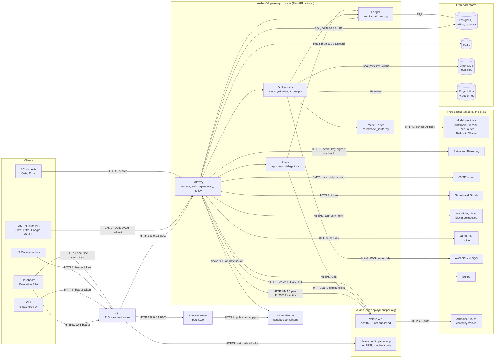

# 01 System context

Who talks to whom, and with what. An edge exists only where a call site was found in the code at commit `e5c23fd`. Edge labels give the protocol and the authentication mechanism.

Derived from:

- Nginx to gateway on 127.0.0.1:8000: `deploy/nginx.conf:40-42`. Preview upstream 127.0.0.1:8100: `deploy/nginx.conf:250-251`. Velaris public host and path allowlist: `deploy/nginx_velaris_public.conf:67-73`.
- Gateway, pipeline and Prime run in one process; the pipeline is started as an asyncio task: `gateway/routers/factory_start_router.py:323`. Prime router is mounted in the same app: `gateway/api.py:289-293`.
- Model providers wired in the router: anthropic `core/model_router.py:510`, bedrock `:514`, gemini `:519`, openrouter `:521`, ollama `:529`. Keys per organisation: `core/model_router.py:57-70`. OpenRouter URL: `core/llm/openrouter_client.py:44`. Ollama default `http://localhost:11434`: `core/llm/client.py:468`.
- Stripe: `gateway/routers/billing_stripe_router.py:42,54,106,143` (checkout session, webhook signature check). Razorpay: `gateway/routers/billing_router.py:24,55`. Provider choice by country: `core/billing/router.py:12-14`.
- SMTP only: `core/notifications/email.py:1-16`. No SendGrid call exists in platform code; the SendGrid hits are in generated-app templates (`core/domain_packs/*`).
- GitHub: `gateway/routers/account_codebase_router.py:163-164`, `core/plugins/connectors.py:79`, `gateway/auth_oauth.py`. GitLab: `core/plugins/connectors.py:183`, `phases/p08_cicd/repo/pr_creator.py`. Slack and Linear: `core/plugins/connectors.py:273,318`. Jira connector: `core/plugins/connectors.py:225`.
- SAML: `gateway/auth_saml.py`. Google and GitHub OAuth: `gateway/auth_oauth.py`. SCIM: `gateway/routers/scim_router.py`.
- LangSmith, opt in with `LANGSMITH_OPT_IN` and key: `core/telemetry/langsmith_tracer.py:31-43`.
- S3: `core/artifact_store.py:249-257`, `orchestrator/artifact_collector.py:93-109`. SQS: `core/queue/sqs_client.py:19-30`. Sentry: `gateway/api_utils.py` (`_init_sentry`).
- ChromaDB: `core/memory/vector_store.py:14,43-50`. pgvector: `core/vector_store.py:1-10`.
- Docker sandbox through the host socket: `Dockerfile:25-26`, `docker-compose.yml:111-135`.
- Dashboard, CLI, extension auth: `cli/aetheros.py:75` and `vscode-extension/src/client.ts:21` send `Authorization: Bearer`. SSE uses a one time token: `gateway/routers/factory_run_streaming_router.py:36-47`.
- Gateway to Velaris, signed client: `core/velaris/client.py:1-20,100-114`. Prime to Velaris: `prime/executors.py:32,194`. Velaris to Prime: `velaris/core/prime.py:156-160` in the Velaris repo (URL and API key env vars, Bearer header in `_client`, near `:50`).
- Velaris to Atlassian OAuth: `velaris/core/atlassian_oauth.py:44-47` in the Velaris repo.

Not shown / not verified:

- Nothing was run. All edges come from reading code, not from traffic.
- The dashboard source under `dashboard/` was not read; the browser to gateway paths come from nginx and router code.
- Velaris has more outbound calls (its own LLM client in `velaris/intel/llm.py`, IMAP/SMTP in `velaris/mail/connector.py`, Google indexing in `velaris/agentkit/hiring_posting.py:24`). They are not drawn; only the Atlassian call was named in the brief.
- The exact header name and scheme used for each model provider and for Stripe or Razorpay was not read call by call; "per org API key" and "secret key" are the credential type, not the header.
- Terraform runs the stack on AWS ECS behind an ALB without nginx (see diagram 05); the nginx edges here describe the single host (compose) deployment.
- The Prime to gateway edge from Velaris uses an `aesk_` style API key by design of `get_current_user` (`gateway/dependencies.py:112`); the exact key type Velaris is given was not checked.
- The CI webhook (`phases/p08_cicd/webhook.py`, authenticated by `require_ci_auth`, `gateway/api.py:306`) is an inbound edge and is not drawn.
