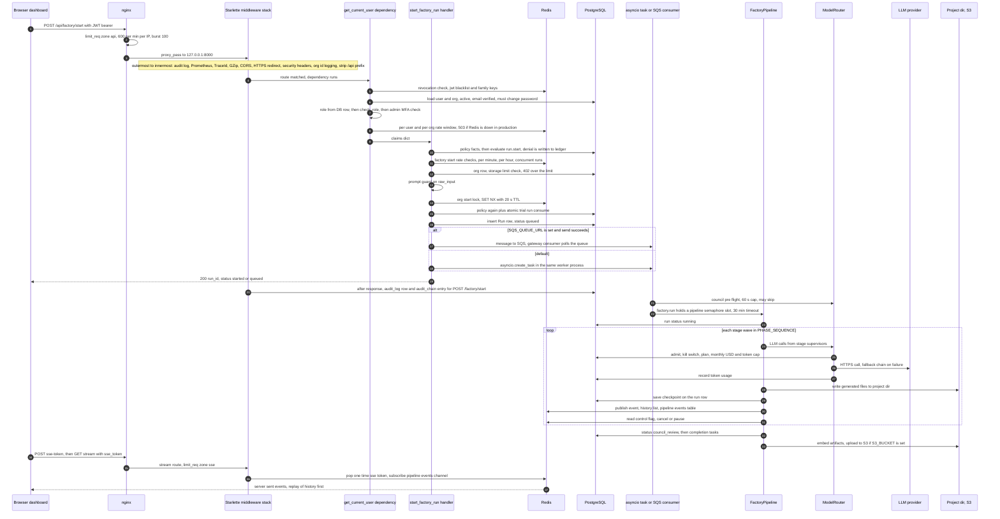
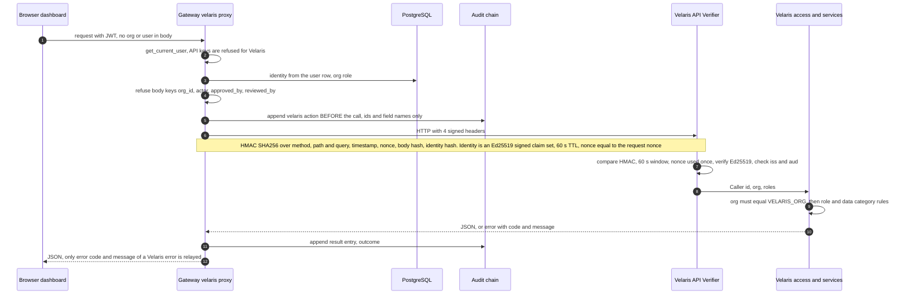

# 02 Call flow: start a factory run

One real request end to end: `POST /api/factory/start` (`gateway/routers/factory_start_router.py:124`), then the background run, then the event stream back to the dashboard. A second, small diagram shows a dashboard call proxied to Velaris.

## 2a. Start of a factory run

## 2b. Dashboard call proxied to Velaris

Derived from:

- Handler order: `gateway/routers/factory_start_router.py:146` (policy), `:150-166` (rate limits), `:169-185` (org and storage), `:241-244` (prompt guard), `:249-250` (start lock and second policy check with trial consume), `:256-272` (Run insert, status `queued`), `:277-321` (SQS), `:323-353` (`asyncio.create_task`).
- Middleware order: registration order in `gateway/api.py`: `strip_api_prefix` `:112`, OrgIDLogging `:123`, SecurityHeaders `:124`, HttpsRedirect `:125`, CORS `:130`, GZip `:138`, TraceId `:140`, Prometheus `:146-150`, audit log `:160`. Starlette puts the last added outermost (comment at `:137`). This order is derived from that rule, not observed in a running app. There is no rate limit middleware, no role middleware and no policy middleware.
- Auth dependency order: `gateway/dependencies.py:50` (decode), `:52` (MFA pending), `:60` (revocation, `gateway/auth_refresh.py:108-136`, 503 if Redis cannot answer), `:68-95` (user, org, email, forced password change), `:99` (plan from org row), `:102` (role from DB, so a demoted admin loses rights at once), `:105` (`check_role`, `gateway/role_gate.py:66-79`), `:106` (`check_admin_mfa`), `:107` (`enforce_api_rate`, `core/api_rate_limit.py:50-69`).
- Policy: `gateway/policy_guard.py:32-49`, `core/policy/enforce.py:63-113`, rules `core/policy/rules.py:53,99-131`. Denials are ledgered at `core/policy/enforce.py:53-60`. Fail closed: `:68-70`.
- Factory start rate limits and concurrent runs: `core/rate_limiter.py` (called at `factory_start_router.py:150-166`). Start lock: `core/start_lock.py:21,29-63`.
- Spend cap: not checked at start. It is checked per LLM call in `core/llm/guard.py:41-76` (kill switch, org policy, `check_budget` with projected cost) and called from `core/model_router.py:146`. Usage is recorded at `core/model_router.py:329-336,395`. Budget code: `core/llm/budget.py:133-190`.
- Background execution: default is an in-process `asyncio.create_task` kept in a strong reference set (`factory_start_router.py:101,323,352`). Run function: `gateway/routers/factory_run_background.py:228-343` (council pre flight `:262-300`, `factory.run` `:303`, post build hooks `:337`). SQS alternative: `core/queue/sqs_client.py:25-27`, consumer started in lifespan `gateway/lifespan.py:250-254`, job runner `core/queue/pipeline_consumer.py:55-118`. Redis is not a job queue.
- Pipeline: semaphore `PIPELINE_MAX_CONCURRENT` default 2 and 30 min timeout `orchestrator/factory_pipeline.py:143-158`; running status `:248`; waves `:408-500`; stage list and critical stages `orchestrator/phase_sequence.py:22-26,90-103`; checkpoint per stage `orchestrator/factory_pipeline.py:688`, stored on the run row `orchestrator/run_state.py:62-76`; control flag `:777-807`; end of run and completion tasks `:811-855`.
- Events: `core/pipeline_state.py:102-130` (pub/sub channel `pipeline:events:{run_id}`, list `pipeline:history:{run_id}`, 24 h expiry, `pipeline_events` table). SSE: `gateway/routers/factory_run_streaming_router.py:36-75,98-211`; nginx stream location `deploy/nginx.conf:117-118`.
- Audit write after the response: `gateway/api.py:160-192`; chain `core/audit/ledger.py:141-190`, `core/audit/chain.py:132-136`.
- S3 and artifact embedding: `orchestrator/artifact_collector.py:66-109`, `core/artifact_store.py:35-93`.
- Velaris proxy: `gateway/velaris_proxy.py:1-18` (rules), `:50` (forbidden body keys), `:99-105` (identity, API key refused), `:108-110` (ledger first). Signing: `core/velaris/client.py:85-114`. Verifier: `velaris/api/auth.py:120-136,148-170` in the Velaris repo; org check `velaris/core/access.py:131-143`.

Not shown / not verified:

- Nothing was run; the order of middleware and the loop are read from code.
- What each stage supervisor does inside a stage (which files, which prompts) was not read. The "write files" step is shown from the project directory and the `output_dir` result (`core/projects.py:16`, `factory_pipeline.py:793`), not from the supervisors.
- Run row creation can fail silently: the insert is in a try block that only logs (`factory_start_router.py:273-274`). The run then has no row until the pipeline saves it at `factory_pipeline.py:248`.
- With SQS, the queue payload carries all fields, but the consumer passes only some of them to `factory.run` (`core/queue/pipeline_consumer.py:100-111`: no personas, mode, intake answers, brand). It also does not call the post build hooks that the in-process path calls. Not run; read only.
- `uvicorn --workers 4` (`Dockerfile:51`) means four processes, each with its own task set and in-memory fallbacks. How runs behave across workers when Redis is absent was not tested.
- Whether the audit middleware sees the `/api` prefix or the stripped path (the inner middleware edits `scope["path"]`) was not tested.
- The Velaris long poll and SSE passthrough variants are not drawn.
