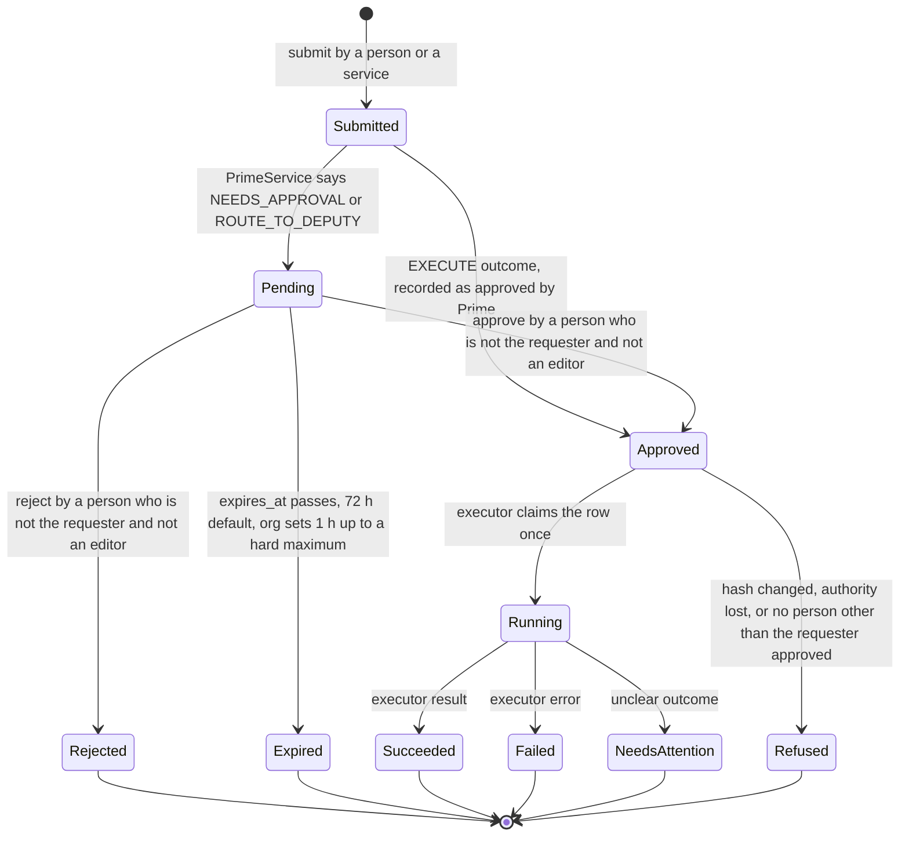
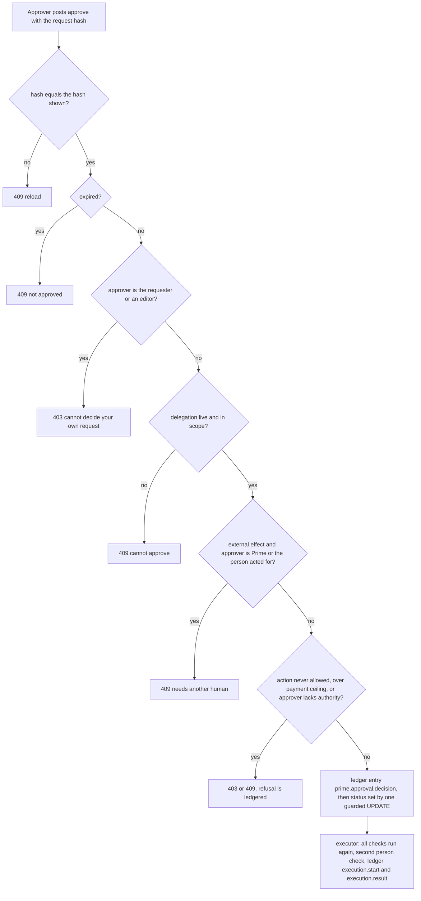
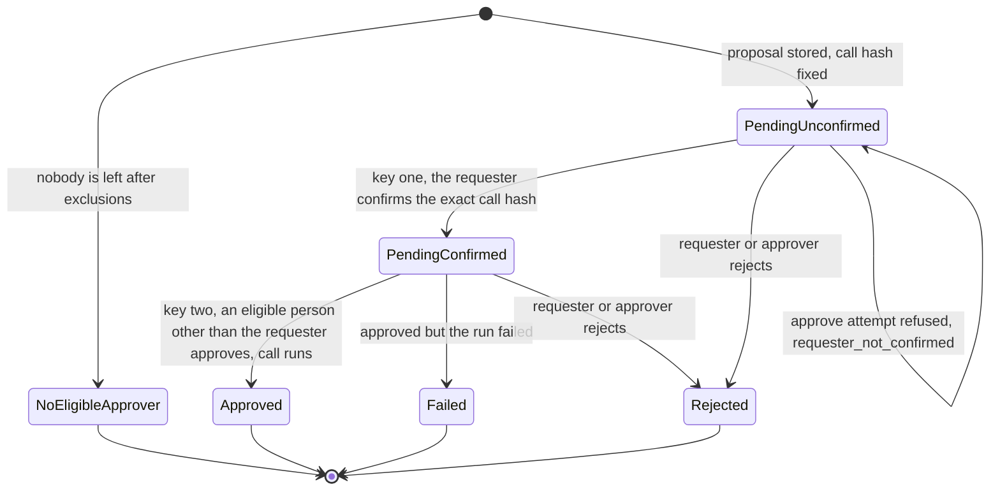
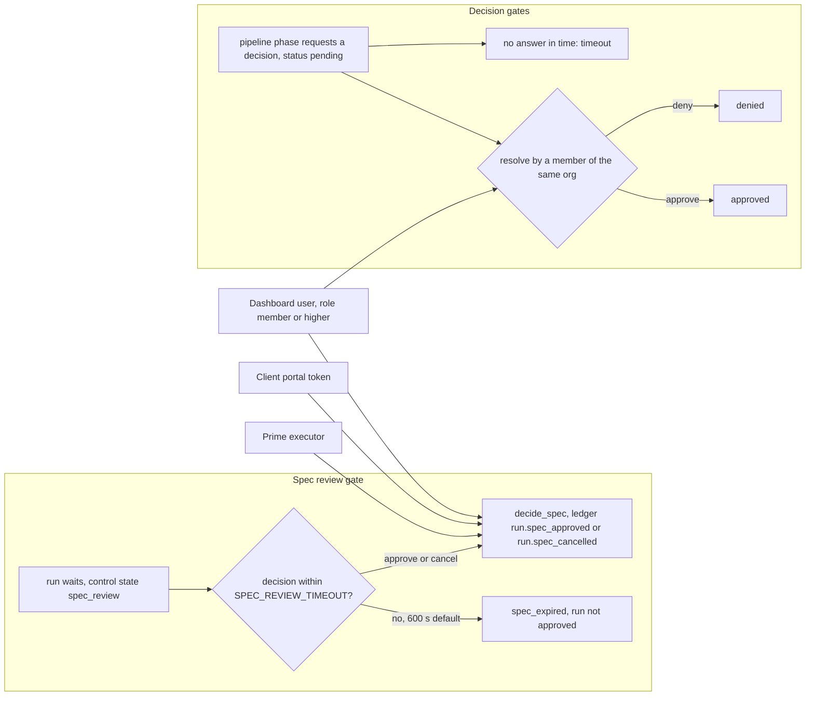

# 03 Approval flow and the second person rule

Where approvals really live at commit `e5c23fd`, who can move each state, and where the "requester cannot approve" rule is and is not enforced.

Summary of what the code does:

| Place | Second person rule enforced? |
| --- | --- |
| Prime requests (`prime/approvals.py`) | Yes, at decision time and again before execution |
| Velaris assistant proposals (`velaris/chat/assistant.py`) | Yes (two keys: requester confirms, someone else approves) |
| Spec review gate in the factory (`core/spec_approval.py`) | No. Any member of the org may approve, including the person who started the run |
| Factory decision gates (`core/decisions/decision_engine.py`) | No. Org check only |
| `core/approval/*` | NOT CONNECTED, see the note below |

## 3a. Prime request (AetherOS)

Gates on the Pending to Approved edge, in this order:

## 3b. Velaris assistant proposal (two keys)

## 3c. Factory gates

Derived from:

- Prime state and TTL: `prime/approvals.py:40` (72 h default), `:85-88` (expired is computed on read from `expires_at`, the row stays `pending`), `:131-165` (submit, `auto` approval at `:154`, request ledger entry `:162`), `:246-295` (decide, ledger entry before the guarded UPDATE `:273-285`), `:364-430` (execute once, claim `:391-393`, ledger start and result `:404-418`).
- Second person rule in Prime: requester and editors refused at `prime/approvals.py:302-305` (this also stops the requester from rejecting); external effect needs a human other than Prime and the person acted for `:311-317`; never list, payment ceiling and authority `:325-342`; `_no_second_person` re-check before execution `:348-361,379-382`; which actions need it: `prime/authz.py:213-216`, `EXTERNAL_EFFECT` `:74`, `NEVER` `:78`.
- Bounds: payment ceiling and hard ceiling `prime/authz.py:219-236`; per org limits and hard maxima for ceiling, delegation days and request lifetime `prime/limits.py:36-47`; delegation limit `prime/authz.py:283-289`.
- Prime routes: `gateway/routers/prime_inbox_router.py:73,144,152`. Ledger writes use `core/audit/chain.append` (`prime/approvals.py:162,264,273,404,417`).
- Velaris two keys: `velaris/chat/assistant.py:1-31` (rule), `:291-306` (eligible approvers: requester, authors of text the model read and recent posters excluded, `approver_exclude_hours` default 24 in `velaris/chat/compliance.py:27`), `:308-315` (live check), `:329-331` (`no_eligible_approver`), `:375-407` (confirm), `:409-446` (decide; `four_eyes` refusal at `:417-420`, `requester_not_confirmed` at `:427-428`). Flow step decision: `velaris/intel/flow.py:372-388` checks only that `by` is not empty; the rule lives in the chat layer above it. Outside approver (Prime pull model): `velaris/core/prime.py:1-27`.
- Spec gate: `orchestrator/spec_review_gate.py:154-181` (timeout and expiry); `core/spec_approval.py:30-56` (checks the run is in the org and waiting, no check of who started the run; ledger `run.spec_approved`); dashboard route `gateway/routers/run_spec_router.py:217-239`; client portal `core/identity/portal_access.py:207`; Prime executor `prime/executors.py:169`.
- Decision gates: `core/decisions/decision_engine.py:133-170` (`resolve`: org check, `AlreadyDecided`, no caller id, no ledger write seen there), routes `gateway/routers/run_spec_router.py:49-168` (policy action `decision.decide` needs role member: `core/policy/rules.py:56`). Timeout status: `decision_engine.py:202,217`. Decision requests come from phases, for example `phases/p01_intake_requirements/gate_engine.py:212`.
- Councils are model reviews, not human approvals: pre flight in strict mode sets run status `rejected` (`gateway/routers/factory_run_background.py:267-294`), delivery council sets the final status (`orchestrator/factory_pipeline.py:811-813`).

NOT CONNECTED: `core/approval/*`

- `core/approval/store.py`, `guarded.py` and `arbitration.py` have no importer outside the package. `core/approval/workflow.py` is imported only by `orchestrator/pipeline_helpers.py:15` (`decide_for_risk`, used at `:293`), and `pipeline_helpers` is imported only by `orchestrator/pipeline.py:40`. That file is the old orchestrator, marked deprecated in `tests/test_pipeline.py:4,18-23`, and no non-test module imports it. So nothing the running gateway does reaches `core/approval`.
- It is not part of the flow above. Do not read it as the approval engine.

Not shown / not verified:

- The clarifying questions and questionnaire routes (`gateway/routers/clarifying_router.py`, `questionnaire_router.py`) were not read. Guided mode pauses a run for an outside respondent (`orchestrator/factory_pipeline.py:590-600`); that is input collection, not shown as an approval.
- Prime action types and executors other than `velaris.flow` and the spec executor were not traced.
- Velaris approval flows other than the chat assistant (for example HR or agent runs gated by Prime) were not traced. Only the `Flow.decide` and gate rules were read.
- Velaris proposals have no expiry in `assistant.py`; none was found, not proven absent in other files.
- When two people decide Prime at the same instant, the loser can leave a ledger entry for a decision that did not win (`prime/approvals.py:270-272`, comment in the code).
- Decision gate `resolve` is check then write, not atomic (comment at `decision_engine.py:151`).
- The `expired` state in Prime is derived, there is no job that writes it; the inbox and decide path compute it. Not tested.
- Nothing was run.
