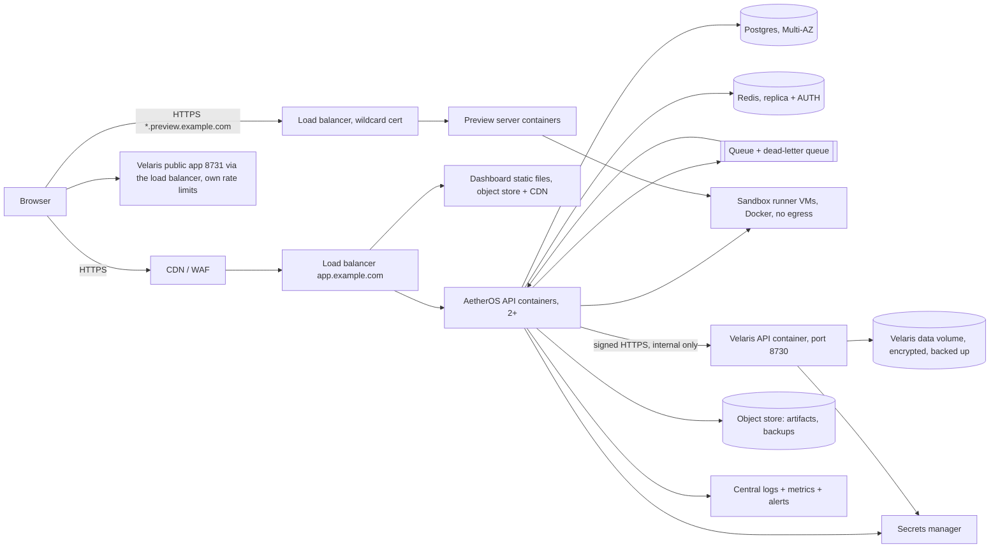

# Reference deployment architecture: AWS Mumbai and Azure Central India (KAN-46)

Status: design, not deployed. The choice of cloud is the owner's decision (KAN-77); this page describes both so either can be
built from `deploy/terraform/aws` (KAN-48, written) or an equivalent Azure module (not written; see "Azure differences").
Nothing here has been applied to an account. Costs are order-of-magnitude estimates, see the cost section.

Regions: AWS `ap-south-1` (Mumbai, three AZs), Azure `centralindia` (Pune, availability zones in the region). Both keep customer
data inside India, which is the data-residency position of the product.

## 1. Principle

Managed containers first (AWS ECS Fargate / Azure Container Apps), managed Postgres, managed Redis, managed queue and object
store. One exception that cannot be managed: **sandbox runners** (the Docker backend, `core/sandbox/docker_backend.py`) need a
real Docker daemon, so they run on a small pool of VMs (EC2 / Azure VM scale set) that nobody else shares. Fargate and Container
Apps do not give the gateway a Docker socket and must never be given one.

## 2. Diagram

## 3. Components

| Component | AWS Mumbai | Azure Central India | Notes |
|---|---|---|---|
| Edge, WAF, CDN | CloudFront + WAF | Front Door + WAF | Static dashboard from the object store behind the CDN |
| Load balancers | ALB (app) + ALB (preview, wildcard cert) | Application Gateway or Container Apps ingress (two hostnames) | Preview hosts must never share the app origin |
| API (gateway) | ECS Fargate service, 2+ tasks, autoscale on CPU and request count | Container Apps app, min 2 replicas | Stateless; state is in Postgres/Redis/object store |
| Pipeline workers | today the queue consumer runs inside each API task (`core/queue/pipeline_consumer.py`, `PIPELINE_MAX_CONCURRENT` per task); a separate worker service is a later split | same | Scale API tasks on CPU now, on queue depth once load is known; bulkhead per job class (KAN-49) |
| Velaris API | Fargate service, 1 task per organisation, internal only | Container App, internal ingress | One organisation per deployment (`VELARIS_ORG`); 1 worker (see `velaris_knackforge/deploy/README.md`) |
| Velaris public app | second Fargate service behind the app ALB path rules | second Container App | Public surface 8731 only |
| Sandbox runners | EC2 Auto Scaling group (Docker, no instance profile, egress blocked by security group) | VM scale set, NSG denies egress | Private subnet, only the pipeline workers and preview servers reach them |
| Postgres | RDS PostgreSQL 15, Multi-AZ, encrypted, 7-35 day PITR | Azure Database for PostgreSQL Flexible Server, zone-redundant HA, PITR | `org_id`-first indexes already in the schema; PgBouncer optional |
| Redis | ElastiCache Redis 7 with AUTH, `noeviction` parameter group | Azure Cache for Redis (Standard), `noeviction` | Revocation and rate-limit keys must never be evicted |
| Queue | SQS standard + DLQ (`SQS_QUEUE_URL`, `SQS_DLQ_URL`; client already in `core/queue/sqs_client.py`) | Service Bus queue + dead-letter sub-queue | The Azure path needs a new client module: `core/queue` speaks SQS only |
| Object store | S3 (versioned, encrypted, lifecycle) | Blob Storage (versioning, soft delete) | Artifacts, backups, signed ledger checkpoints in a separate bucket/account |
| Secrets | Secrets Manager (injected as env at task start) | Key Vault (Container Apps secret references) | Nothing in images or manifests |
| Logs, metrics, alerts | CloudWatch Logs + Managed Prometheus/Grafana or CloudWatch alarms | Log Analytics + Azure Monitor | Alert rules in `deploy/observability/alerts.yml` are Prometheus format |
| DNS and certificates | Route 53 + ACM (DNS validated, auto renewal) | Azure DNS + managed certificates or cert-manager | Wildcard for preview: see `docs/ops/PREVIEW_ORIGINS.md` |
| Container registry | ECR (scan on push) | ACR | Images pinned by digest in the service definition |

## 4. Networks

* One VPC / VNet per environment (`staging`, `production`), three tiers of subnets: public (load balancers, NAT), private-app
  (containers), private-data (Postgres, Redis, Velaris volume). Sandbox runners get their own private subnet with no route to the
  data tier and no internet route.
* Only the two load balancers are public. Postgres, Redis, Velaris 8730, the metrics ports and the sandbox hosts have no public
  address. Security groups (NSGs) allow: ALB -> API 8000; API -> Postgres 5432, Redis 6379, Velaris 8730; API tasks -> sandbox
  hosts Docker TLS port only; preview servers -> sandbox published app ports only.
* Outbound from the app tier goes through NAT with an allowlist where the provider supports it (model providers, connectors).
  Outbound calls already carry timeouts and an SSRF guard (`core/security`).
* Prometheus scrape of Velaris `/metrics` uses the internal listener only (`VELARIS_METRICS_PORT`, single worker).

## 5. Per-tenant isolation

Tenants are rows (`org_id`) plus the controls already in code: org-first indexes, per-org rate limits, per-org model spend caps,
per-org API keys, ledger chains per organisation. The infrastructure adds:

* Velaris is one deployment (and one data volume, one KMS key, one key for personal-data stores) per organisation: a Velaris
  breach or restore never crosses organisations.
* Generated apps run in sandbox containers on dedicated VMs with no cloud credentials (no instance profile / managed identity),
  no network except their published port, read-only root, non-root user, CPU and memory limits (`core/sandbox/docker_backend.py`).
  Previews are served only from `<run-id>.<preview host>`, a different registrable origin from the dashboard.
* An enterprise customer who needs hard isolation gets a dedicated stack (same Terraform, new workspace/state, own database);
  the shared stack is for everyone else.

## 6. Backup and recovery

* Postgres: automated backups with point-in-time recovery (RPO minutes) plus a daily logical dump to a separate bucket/account
  (`scripts/db_backup.sh`).
* Ledger: the hash-chained audit ledger lives in Postgres; the **signed checkpoints** are copied to a bucket in a different
  account/subscription with object lock, so tampering with Postgres cannot also rewrite its own proof (KAN-51).
* Velaris data volume: snapshot schedule + the backup script in `velaris_knackforge/deploy/backup`.
* Redis is a cache plus security counters; it is rebuilt, not restored. Loss of Redis must not re-enable revoked tokens: revocations
  are also persisted in Postgres (see the runbook "Redis").
* Restore drill: `scripts/restore_drill.sh` (KAN-51), targets RTO 60 minutes for one organisation, RPO 15 minutes.

## 7. Cost estimate (INR per month, small production)

Assumptions: 2 API tasks, 2 worker tasks, 1 Velaris API + 1 public task, 1 preview task, Postgres Multi-AZ medium, small Redis,
1 sandbox VM, 100 GB storage, moderate traffic, USD 1 = INR 88. **These are list-price estimates from memory, accurate to roughly
plus or minus 30 percent. They are not a quote.** Re-run them in the AWS Pricing Calculator / Azure Pricing Calculator for the
chosen region before anyone approves a budget. Model-provider spend is excluded and dominates at scale (see `COST_MODEL.md`).

| Item | AWS Mumbai (INR / month) | Azure Central India (INR / month) |
|---|---|---|
| Containers (7 small tasks / replicas) | 13,000 | 12,000 |
| Postgres, Multi-AZ, 100 GB | 17,000 | 16,000 |
| Redis, small | 3,500 | 4,500 |
| Sandbox VM (2 vCPU class) x1 | 6,000 | 6,000 |
| Load balancers (2) + WAF | 5,500 | 6,000 |
| NAT / egress | 4,500 | 4,000 |
| Object store, queue, secrets, registry | 2,000 | 2,000 |
| Logs and metrics | 3,000 | 3,500 |
| Total | about 55,000 | about 54,000 |

Growth: containers and the sandbox pool scale linearly; Postgres moves up one size per roughly doubling of active organisations.

## 8. What differs between AWS and Azure

* Queue: AWS path works today (SQS client in repo); Azure needs a Service Bus client behind the same interface (not written).
* Container Apps has no per-service security group; isolation uses subnets, NSGs and internal ingress. Fargate uses security groups
  per service.
* Sandbox hosts: AWS EC2 with no instance profile; Azure VM with no managed identity. IMDS must be blocked in both
  (`169.254.169.254`), already part of the sandbox network policy.
* Secrets: Secrets Manager injects at task start; Container Apps reads Key Vault references (needs a managed identity on the app
  itself, not on sandboxes).
* Wildcard certificate: ACM issues it free and renews itself with DNS validation in Route 53; on Azure use cert-manager with
  Azure DNS DNS-01, or a purchased wildcard stored in Key Vault.
* Regions: Mumbai has three AZs and the full service set; Azure Central India supports zones but some SKUs lag, check before sizing.
* Terraform: provider differs, module layout the same (network, data, compute, edge, observability).

## 9. Open decisions for the owner

1. Cloud (KAN-77). Until then `deploy/terraform/aws` is the default module.
2. Whether Velaris is one deployment per organisation (recommended) or pooled (requires multi-org Velaris, not built).
3. Whether enterprise customers get dedicated stacks.
4. Budget approval after the calculator re-run.
